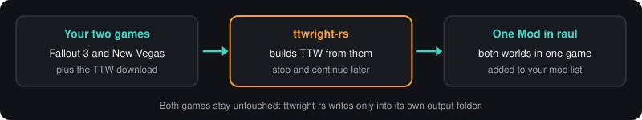
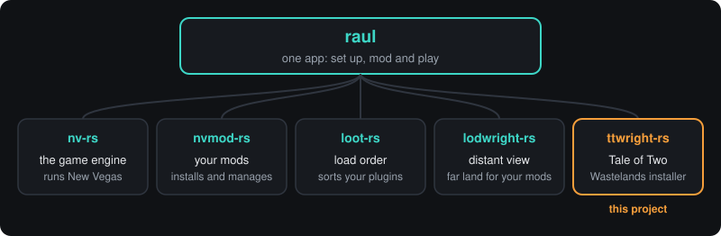

# ttwright-rs

**ttwright installs [Tale of Two Wastelands](https://taleoftwowastelands.com/)**, the mod that brings Fallout 3's
world into Fallout: New Vegas, so you can play both games' stories in one. It builds it from your own copies of both
games, on Linux, Windows and macOS, and leaves both games untouched.

  

## What you see

ttwright is the **Tale of Two Wastelands** page of [raul](https://github.com/JorisJonkers-dev/rauls-trusty-toolbox):
pick your games and the TTW download, check the space it needs, and install.

  
  

## What it does for you

- 🐧 **Any system**: runs natively on Linux, Windows and macOS; Linux needs no Windows tools.
- ⏸️ **Stop and continue**: cancel an install and pick it up later where it stopped.
- 🛡️ **Safe**: it writes only into its own output folder, and checks the package before it writes anything.
- 🧩 **One Mod**: raul adds the result to your mod list as one Mod.

You need your own Fallout 3 and Fallout: New Vegas, and the TTW package from
[mod.pub](https://mod.pub/ttw/133/files) (TTW 3.3 and 3.4 are supported).

<!-- Progress picture: docs/coverage/tally.svg goes here once the feature catalogue reaches this repository. -->

## How it fits together

  

ttwright is one part of raul. As its own project it is tested on its own, and it keeps the history of the installer it
was rewritten from, [SulfurNitride/TTW_Linux_Installer](https://github.com/SulfurNitride/TTW_Linux_Installer).

## Get it

**[Download raul](https://github.com/JorisJonkers-dev/rauls-trusty-toolbox/releases/latest)**: ttwright is built in.
It also works on its own from the command line ([docs/USAGE.md](docs/USAGE.md)).

## Learn more

- [Using ttwright](docs/USAGE.md): raul's TTW page, supported versions, getting the package, the commands, downloads.
- [More detail](docs/OVERVIEW.md): where it comes from, why it is its own project, building it.

No game files and no TTW package are in this repository or its releases. Licence: GPL-3.0-only ([LICENSE](LICENSE)).
Report problems here, not upstream ([FORK.md](FORK.md)).
